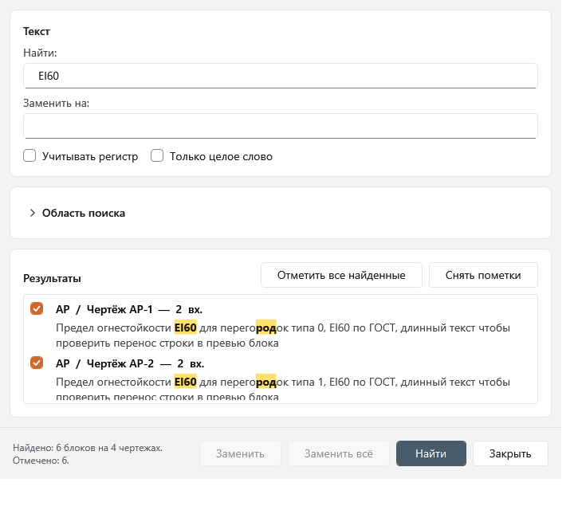

# Поиск и замена текста для Renga

Плагин для [Renga](https://rengabim.com): ищет и заменяет текст в текстовых блоках на чертежах проекта — по образцу диалога «Найти и заменить» в Microsoft Word.

**Версия 0.2**

_Скриншот — отрисовка окна в тестовом приложении на условных данных._

## Возможности
- Отдельная кнопка «Поиск и замена текста» на ленте Renga.
- Поиск по всем чертежам проекта или только по выбранным разделам и чертежам (блок «Область поиска»).
- Опции «Учитывать регистр» и «Только целое слово».
- Список результатов: чертёж с разделом и текст блока с подсвеченным найденным фрагментом; каждый результат можно отметить или снять отметку.
- «Заменить» меняет только отмеченные блоки, «Заменить всё» — все найденные. Заменяется только найденный фрагмент, форматирование блока сохраняется.
- Вся замена — одна операция Renga: откатывается одним Ctrl+Z.
- Итог замены показывается в строке состояния внизу окна.
- Оформление в стиле Windows 11, поддержка режима высокой контрастности.

## Ограничения
- Ищутся только текстовые блоки на чертежах. Выноски, текст в моделях, спецификациях, легендах и таблицах не обрабатываются.
- Поиск — по точному вхождению подстроки, без регулярных выражений.
- Фрагмент, разбитый на границе двух форматированных участков одного блока, не находится (блок при этом не повреждается).

## Требования
- Windows, Renga с поддержкой плагинов .NET 8 (в манифесте указан API 2.49).

## Установка
1. Скачайте архив `TextSearchReplace-0.2.zip` на странице [Releases](../../releases).
2. Закройте Renga.
3. Распакуйте архив и скопируйте папку `TextSearchReplace` в `C:\Program Files\Renga Professional\Plugins\` (потребуется подтверждение администратора). Если стояла старая версия — предварительно удалите её папку.
4. Запустите Renga: на ленте появится кнопка «Поиск и замена текста».

Если кнопки нет, проверьте журнал `%localappdata%\Renga Software\Renga\AecApp.log`.

## Удаление
Закройте Renga и удалите папку `Plugins\TextSearchReplace`.

## О разработке
Плагин разработан с помощью искусственного интеллекта (Claude, Anthropic) под руководством автора. Работа плагина проверена автором в Renga, но программа поставляется «как есть», без гарантий: перед массовой заменой на важных проектах сохраните копию проекта и проверьте результат.

## Лицензия
Все права защищены, см. [LICENSE](LICENSE). Исходный код не публикуется. Сторонние компоненты: сборки Renga SDK.
